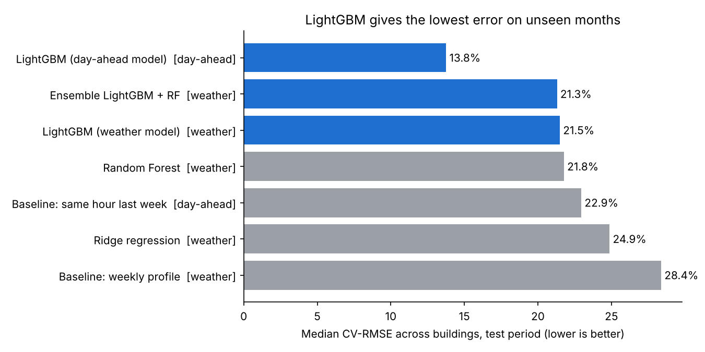
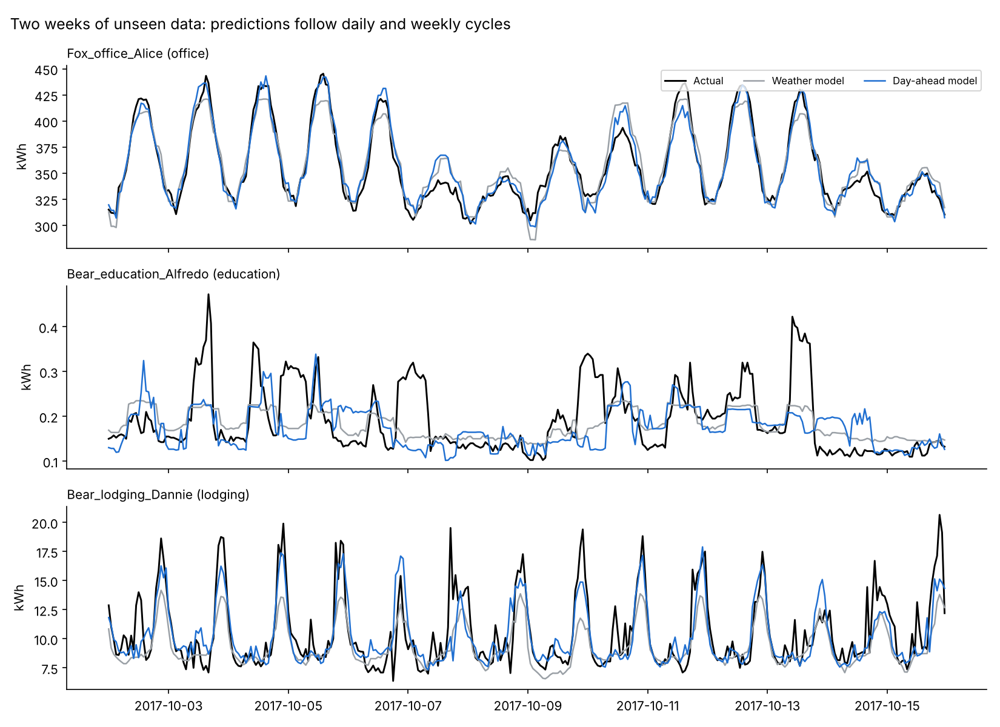

# Baseline AI

**Building energy consumption prediction with AI.** Baseline AI predicts the hourly electricity use of real buildings from
weather, calendar and building data, then uses the predictions to **detect energy waste** and **measure retrofit
savings**. Pure software: public data, Python, no hardware.

Developed by **COMPILIX INNOVATIONS**, the research lab of **SPASU BAC Students** (Algeria).
Lead researcher: Abdelouahab KRIM. Research paper: [`paper/Baseline-AI-research-paper.pdf`](paper/Baseline-AI-research-paper.pdf).
Website and interactive platform: https://baselineai.bacai.space

## Results (test period Jul–Dec 2017, never seen in training)

| Model | Task | Median CV-RMSE | Median abs NMBE | RMSLE | Within accuracy limits |
| --- | --- | --- | --- | --- | --- |
| **LightGBM (day-ahead model)** | day-ahead | 13.8% | 1.3% | 0.205 | 88% |
| Baseline: same hour last week | day-ahead | 22.9% | 1.2% | 0.324 | 73% |
| Ensemble LightGBM + RF | weather | 21.3% | 6.5% | 0.426 | 58% |
| **LightGBM (weather model)** | weather | 21.5% | 6.4% | 0.425 | 59% |
| Random Forest | weather | 21.8% | 6.7% | 0.432 | 58% |
| Ridge regression | weather | 24.9% | 7.6% | 0.447 | 52% |
| Baseline: weekly profile | weather | 28.4% | 8.6% | 0.421 | 44% |

Per building, then the median building. Within accuracy limits = hourly CV-RMSE ≤ 30% and |NMBE| ≤ 10%.
The day-ahead model cuts the error of the "same hour last week" baseline by about
40%.

**Application tests** (`reports/validation.json`):

| Test | Setup | Result |
| --- | --- | --- |
| Fault detection | +50% for 5 days in 100 random buildings | 74% of fault days caught |
| Fault detection | +30% for 5 days in 100 random buildings | 55% caught, 3.6% of normal days flagged |
| Savings (M&V) | known 15% saving after 2017-10-01, 3 months, baseline retrained on prior data | median error 6.7 points, 65% within 10 points |
| Savings placebo | no saving applied | median estimate -1.6% (ideal 0) |

Savings of a few percent are hard to confirm over three months in single buildings; the method suits large retrofits
or longer measurement periods.





## Data

The open [Building Data Genome 2](https://github.com/buds-lab/building-data-genome-project-2) dataset (CC BY 4.0),
cleaned electricity meters, downloaded from a public mirror by `src/download.py`:

- 591 buildings on 4 university campuses (sites Bear, Fox, Panther, Rat), hourly kWh, 2016–2017
- hourly outdoor temperature and humidity per site
- building type from the meter name (education, office, lodging, public, assembly ...)
- 9.2 million hourly readings after cleaning

Cleaning removes non-positive values, frozen meters (same value for 24+ hours) and spikes (above 5x the
building's 99th percentile).

## Method

| Step | File | What it does |
| --- | --- | --- |
| 1 | `src/download.py` | Downloads the 12 CSV files (~70 MB) |
| 2 | `src/data.py` | Cleans meters, merges weather, keeps buildings with enough data |
| 3 | `src/features.py` | Calendar, weather (dew point, degree hours, rolling temperature), building profiles, lags |
| 4 | `src/train.py` | Baselines, Ridge, Random Forest, LightGBM weather model, LightGBM day-ahead model |
| – | `src/tune.py` | Feature and hyper-parameter comparison on validation months (May–Jun 2017) |
| 5 | `src/explain.py` | SHAP explanations and report figures |
| 6 | `src/anomalies.py` | Anomaly detection, fault-injection test, savings (M&V) test |
| 7 | `app/dashboard.py` | Streamlit dashboard |
| 8 | `src/export_site.py`, `docs/` | Landing page with an in-browser platform (GitHub Pages) |
| 9 | `src/paper_figures.py`, `paper/` | Research paper (LaTeX) and its figures |
| – | `src/import_csv.py` | Bring your own hourly meter CSV |

**Two models for two jobs**

- **Weather model** – knows only the building, weather and calendar. It answers *"how much should this building use?"*,
  which is what anomaly detection and savings verification need.
- **Day-ahead model** – also knows consumption up to the previous day (lags of 24 h and more). It answers
  *"how much will this building use tomorrow?"* for operational planning.

**Validation** – strict time split: train on 2016-01-01 to 2017-06-30, test on 2017-07-01 to 2017-12-31.
Building profiles (target encodings) are computed from the training period only. Features, settings and the number
of trees are chosen on May–June 2017 with profiles learned only from data before May, so the test set is never used
for any decision.

**Metrics** – CV-RMSE and NMBE per building (standard hourly limits: CV-RMSE ≤ 30%, |NMBE| ≤ 10%),
plus RMSLE, MAE and MAPE.

## Run it

```bash
pip install -r requirements.txt
./run_all.sh                     # full pipeline, about 30-40 min on a 4-core laptop
streamlit run app/dashboard.py   # open http://localhost:8501
```

Or step by step: `python -m src.download`, `python -m src.data`, `python -m src.train`,
`python -m src.explain`, `python -m src.anomalies`, `python -m src.export_site`.

Use your own meters: `python -m src.import_csv my_meters.csv --train-end YYYY-MM-DD`, then run `src.train`,
`src.explain` and `src.anomalies`. Required columns: `timestamp, building_id, kwh, temperature, humidity`
(optional `site`, `primary_use`).

## Website

`docs/` is a static landing page with an interactive platform (forecasts, anomalies, savings simulator, SHAP drivers)
for 24 representative buildings. Refresh its data with `python -m src.export_site`. Preview locally with
`python -m http.server -d docs 8000`. Deploy with GitHub Pages (Settings → Pages → branch `main`, folder `/docs`).


## Film

`docs/media/baseline-ai-film.mp4` is a 1 min 43 s motion-graphics film with an English voice-over and captions,
shown at the top of the website. It is generated entirely from code in `video/`: the voice-over with the open-source
Kokoro text-to-speech model, a synthesised music bed, and animations drawn from the project's real results.
Rebuild it with `video/build.sh` (needs ffmpeg, Node.js with Playwright, and the Kokoro model files listed in
`video/voiceover.py`).

## Outputs

- `reports/model_comparison.csv` – all models, all metrics
- `reports/per_building_*.csv`, `reports/by_primary_use_*.csv` – error per building and per building type
- `reports/shap_importance_*.csv`, `reports/figures/` – explainability and charts
- `reports/anomaly_events.csv`, `reports/validation.json` – anomalies and validation tests
- `models/lgbm_weather.txt`, `models/lgbm_day_ahead.txt` – trained LightGBM models

## Limitations and next steps

- Weather has only temperature and humidity; adding solar radiation and cloud cover should help.
- No building floor area or occupancy data in this mirror.
- The LSTM/Transformer models from the project plan are not included yet; LightGBM is the main model.
- Anomaly validation uses synthetic faults; real fault labels from facility teams would give a stronger test.
- Next: probabilistic forecasts (quantiles), transfer learning to new buildings, an RL controller using the forecasts.
